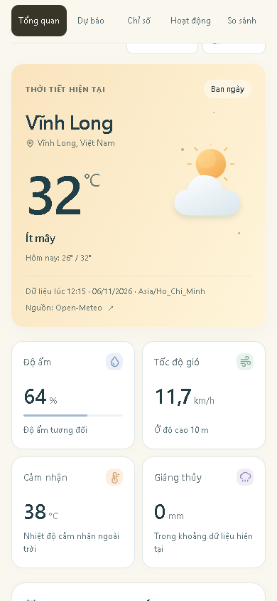
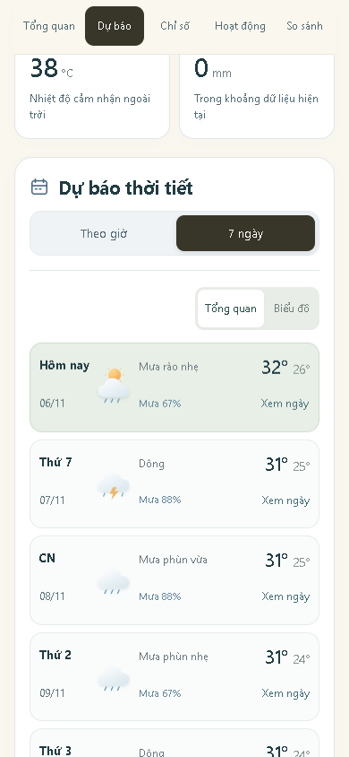

TRƯỜNG KỸ THUẬT VÀ CÔNG NGHỆ

KHOA CÔNG NGHỆ THÔNG TIN

BÁO CÁO ĐỒ ÁN CHUYÊN NGÀNH

Xây dựng ứng dụng Web hỗ trợ tra cứu và hiển thị thông tin thời tiết

Sinh viên thực hiện  Lê Đăng Huy

Mã số sinh viên  110123013

Lớp  DA23TTA

Giảng viên hướng dẫn  ThS Lê Minh Tự

Phiên bản ứng dụng 2.1.1
Cập nhật báo cáo ngày 03 tháng 11 năm 2026

Báo cáo mô tả mã nguồn, kết quả kiểm thử và phạm vi đã triển khai. Thể thức và nhận xét của giảng viên được bổ sung theo quy định của khoa.

# Tóm tắt và nội dung báo cáo

Ứng dụng Thời tiết hỗ trợ tìm địa điểm, xem thời tiết hiện tại và dự báo theo giờ hoặc trong bảy ngày. Website sử dụng HTML5, CSS3, Bootstrap và JavaScript thuần; dữ liệu được lấy từ Open-Meteo bằng REST API, đọc JSON và cập nhật nội dung trong cùng một trang. Bản này bổ sung thông tin không khí, gợi ý hoạt động, so sánh hai nơi, định vị và danh sách địa điểm lưu trên trình duyệt.

Kết quả được đối chiếu với đề cương chi tiết và minh chứng kèm theo. Bộ kiểm thử đạt 28 kiểm tra logic, 70 nhóm trình duyệt và 2 kiểm tra khởi động; kiểm tra bổ sung bằng API thật xác nhận nhiệt độ và bố cục màn hình nhỏ. Website không sử dụng phản hồi mô phỏng để hiển thị khi chạy thực tế. Dữ liệu từ API là sản phẩm mô hình khí tượng, không phải cam kết dự báo đúng tuyệt đối.

1 Tổng quan và phạm vi

2 Khảo sát tài liệu và cơ sở công nghệ

3 Phân tích yêu cầu

4 Thiết kế và luồng xử lý

5 Dữ liệu API và cách ánh xạ

6 Xử lý lỗi và hoàn thiện mã nguồn

7 Giao diện trên máy tính

8 Giao diện trên màn hình nhỏ

9 Phương pháp và kết quả kiểm thử

10 Kiểm thử độ bền và giới hạn

11 Hướng dẫn sử dụng và trình bày

12 Kết luận và hướng phát triển

Tài liệu tham khảo

# 1 Tổng quan và phạm vi

Người dùng cần biết nhiệt độ, tình trạng trời, độ ẩm, gió và dự báo để chuẩn bị cho sinh hoạt hoặc di chuyển. Mục tiêu đồ án là thực hiện luồng nhập địa điểm, chọn đúng nơi và trình bày dữ liệu thời tiết dễ đọc trên máy tính và điện thoại. Phần nghiên cứu tập trung vào HTTP, REST API, JSON, xử lý bất đồng bộ và bố cục thích ứng, theo các mục 5, 6, 7 và 10 của đề cương [6].

Ứng dụng là website tĩnh, không có cơ sở dữ liệu nghiệp vụ hay mô hình tự dự đoán thời tiết. Địa điểm yêu thích và lịch sử chỉ lưu trong trình duyệt. Website công khai không yêu cầu tài khoản; việc thay đổi quyền truy cập tại nơi lưu trữ là cấu hình triển khai, không phải chức năng quản lý tài khoản do đồ án xây dựng.

Phương pháp thực hiện gồm đối chiếu yêu cầu, đọc tài liệu dịch vụ, phân tích phản hồi JSON và thử nghiệm với nhiều địa điểm, trạng thái lỗi, kích thước màn hình. Chưa thực hiện phỏng vấn hoặc khảo sát bằng bảng hỏi; báo cáo không đưa số liệu hài lòng người dùng hoặc nhật ký các tuần chưa diễn ra.

# 2 Khảo sát tài liệu và cơ sở công nghệ

Khảo sát nguồn tài liệu và giao diện dịch vụ cho thấy hai cách tiếp cận thường gặp: ưu tiên số liệu tại một địa điểm hoặc trình bày nhiều lớp bản đồ. Với phạm vi đề tài, giao diện thẻ số liệu và biểu đồ giúp tập trung vào thao tác tra cứu. Bản triển khai không sao chép chức năng radar hoặc cảnh báo thiên tai khi chưa có nguồn dữ liệu tương ứng.

| Tiêu chí | Open-Meteo | OpenWeather |
| --- | --- | --- |
| Cách lấy dữ liệu | API trả JSON theo tọa độ | Current Weather trả dữ liệu theo tham số truy vấn |
| Cấu hình của đồ án | API công khai được chọn cho bản giáo dục | Current Weather yêu cầu appid |
| Vai trò trong đề tài | Nguồn địa điểm, thời tiết và không khí | Đối chiếu tài liệu, không gọi trong website |

HTML cung cấp biểu mẫu và cấu trúc nội dung; CSS tổ chức bố cục và màu theo thời tiết. Bootstrap 5.3.3 được lưu cục bộ để thống nhất điều khiển. JavaScript sử dụng fetch và response.json, kiểm tra response.ok, hủy yêu cầu cũ bằng AbortController rồi cập nhật DOM. Các lựa chọn này phù hợp ứng dụng đơn trang có quy mô nhỏ [1–4].

# 3 Phân tích yêu cầu

Các yêu cầu cốt lõi xuất phát từ ảnh mô tả và đề cương. Những phần mở rộng hỗ trợ sử dụng thực tế nhưng không thay thế các chức năng bắt buộc. Tài liệu DOI_CHIEU_DE_CUONG_03_11.md ghi thêm đường dẫn mã nguồn và giới hạn nghiệm thu.

| Mã | Yêu cầu và điều kiện chấp nhận | Thành phần thực hiện |
| --- | --- | --- |
| YC01 | HTML5, CSS3, JavaScript, Bootstrap; một trang | dist/index.html; dist/css; dist/js |
| YC02 | Tìm tên, phân biệt tỉnh/quốc gia, đổi địa điểm | app.js; Geocoding API |
| YC03 | Nhiệt độ, độ ẩm, gió, tình trạng và đơn vị | app.js; validateWeather và renderWeather |
| YC04 | Dự báo ngắn hạn, xem đúng ngày đang chọn | daily-view.js; dashboard.js; bảy ngày và từng giờ |
| YC05 | REST API/JSON, báo lỗi nhập sai hoặc mạng | fetchJSON; kiểm tra đơn vị, mảng, miền giá trị |
| YC06 | Bố cục phù hợp máy tính và điện thoại | CSS thích ứng; kiểm tra 320–1440 px |
| YC07 | Thực nghiệm, sửa lỗi, mã nguồn và báo cáo | tests; docs; báo cáo Word và minh chứng |

## Yêu cầu bổ sung

Người dùng có thể chọn một ngày trong dữ liệu API, xem giờ dự báo, so sánh thời tiết hiện tại tại hai nơi, lưu tối đa sáu địa điểm yêu thích và tám địa điểm vừa tra cứu. Các tiện ích bổ sung gồm US AQI, PM2.5, PM10, NO₂, O₃; định vị có xin phép; bản đồ vị trí thiết bị; liên kết địa điểm; cập nhật định kỳ tùy chọn.

Gợi ý hoạt động sử dụng số liệu API, phân biệt hiện tại và dự báo. Nền và biểu tượng thay đổi theo mã thời tiết cùng is_day. Giao diện luôn nêu dữ liệu thiếu hoặc cũ; không điền số ngẫu nhiên và không đổi null thành 0.

# 4 Thiết kế và luồng xử lý

Luồng chính: nhập tên → Geocoding API → chọn đúng địa điểm → Forecast API → kiểm tra JSON → cập nhật thời tiết, ngày, giờ, gợi ý và giao diện. API không khí được gọi riêng theo tọa độ đã tải thành công. Đổi nơi nhanh sẽ hủy hoặc bỏ qua phản hồi đến muộn, tránh ghép tên địa điểm mới với số liệu cũ.

| Tệp hoặc nhóm | Trách nhiệm |
| --- | --- |
| app.js | Tìm địa điểm, truy vấn, kiểm tra phản hồi, trạng thái và thời tiết chính |
| daily-view.js; dashboard.js | Chọn ngày; dự báo giờ, biểu đồ và các chỉ số mở rộng |
| features.js | Yêu thích, lịch sử và so sánh thời tiết hai nơi |
| weather-config.js; recommendations.js | Ngưỡng tham khảo và xếp hạng giờ hoạt động |
| weather-theme.js; assets/weather.svg | Ánh xạ trạng thái và bộ biểu tượng thời tiết |
| location.js; my-map.js | Quyền vị trí, tọa độ thiết bị và liên kết bản đồ |
| live-data.js | Nguồn, thời điểm, kiểm tra dữ liệu không khí và liên kết |

Trạng thái thời tiết chỉ được thay sau khi phản hồi hợp lệ. Nếu tải nơi mới thất bại, dữ liệu lần trước vẫn có tên và mốc thời gian đi kèm thông báo. Danh sách yêu thích/lịch sử lưu tên và tọa độ trong localStorage; chọn lại sẽ gọi API mới. Website không dùng JSON minh chứng làm bộ nhớ thời tiết ngoại tuyến.

# 5 Dữ liệu API và cách ánh xạ

Ứng dụng gọi Geocoding API để tìm địa điểm, Forecast API để lấy current, hourly, daily với timezone=auto và forecast_days=7, cùng Air Quality API để lấy chỉ số không khí. Đơn vị hiển thị được đối chiếu với các trường units trong phản hồi; thông tin nguồn và mốc dữ liệu luôn có thể xem trên trang [1–3].

| Nhóm dữ liệu | Cách dùng trong ứng dụng |
| --- | --- |
| current | Nhiệt độ, cảm nhận, độ ẩm, gió, mưa, mã trạng thái và ngày/đêm |
| hourly | Thẻ giờ, biểu đồ và khung giờ cho đi bộ, chạy bộ, đạp xe |
| daily | Cao/thấp, mưa, gió, UV, mặt trời mọc/lặn theo đúng ngày |
| current của Air Quality | US AQI và nồng độ; ghi nguồn Open-Meteo/CAMS và mốc riêng |

# 6 Xử lý lỗi và hoàn thiện mã nguồn

Kiểm tra dữ liệu bao gồm số hữu hạn, miền độ ẩm/xác suất, gió và lượng mưa không âm, ngày hợp lệ, độ dài mảng tương ứng và đơn vị. Trường tùy chọn thiếu được hiển thị chưa có dữ liệu. Mã thời tiết chưa biết dùng biểu tượng trung tính; dữ liệu không khí hỏng không bị phân loại thành chất lượng tốt.

Tên không hợp lệ không gửi API. HTTP 429, lỗi dịch vụ, JSON hỏng, mất mạng và vượt thời gian chờ được chuyển thành thông báo có thể thử lại. Dữ liệu bên ngoài được chèn như văn bản; URL chia sẻ kiểm tra tọa độ và giới hạn tên. Khóa API bí mật không nằm trong mã trình duyệt.

Nút định vị phân biệt bị chặn quyền, chưa xác định được tọa độ và hết thời gian chờ; có hủy. Khi lấy vị trí thất bại, bản đồ không mở tọa độ giả. Chương trình chạy cục bộ tự thử cổng kế tiếp nếu cổng đang bận, không đóng chương trình khác. Có thể chạy từ thư mục làm việc khác mà vẫn phục vụ đúng dist.

## Gợi ý và giao diện theo thời tiết

Ngưỡng đặt trong weather-config.js: cảm nhận thấp hơn 18°C gợi ý áo khoác; từ 32°C lưu ý nóng; khả năng mưa từ 60% có căn cứ nhắc chuẩn bị che mưa. Đây là tiêu chí tham khảo của ứng dụng, không phải chuẩn khí tượng hoặc y tế. Chỉ tạo lời nhắc khi có dữ liệu phù hợp.

Gợi ý ngoài trời xét các khung đủ một giờ ban ngày trong 24 giờ tới, hoặc ngày dự báo được chọn. Kiểm tra cả đầu và cuối khung; loại giông, mưa lớn, gió từ 30 km/h và các điều kiện loại trừ trong cấu hình. Ưu tiên giờ thuận lợi trước, sau đó đến giờ cần cân nhắc; tối đa ba khung. Người dùng vẫn mở được từng giờ có đủ dữ liệu để xem lý do không khuyến nghị. Khi không có giờ phù hợp, trang nêu nguyên nhân và gợi ý trong nhà.

Màu nền, màu nhấn và biểu tượng dựa trên mã WMO của API; is_day quyết định ngày/đêm tại địa điểm. Ban đêm vẫn phân biệt mây, mưa và giông. Trạng thái tải/lỗi có giao diện mặc định; hiệu ứng giảm khi trình duyệt bật prefers-reduced-motion.

# 7 Giao diện trên máy tính

Hình 1 Giao diện dùng API thật trong phiên kiểm tra ngày 03/11/2026

Cột tìm kiếm và các địa điểm lưu nằm bên trái. Vùng nội dung có chọn ngày và điều hướng nhanh đến hiện tại, từng giờ, bảy ngày, chỉ số, không khí, hoạt động và so sánh. Logo và biểu tượng được lấy từ các tài nguyên SVG cục bộ; các thẻ dự báo có kích thước biểu tượng nhất quán.

Các nút tải JSON và mở phản hồi API đã được bỏ khỏi giao diện theo yêu cầu sử dụng. Phần ghi nguồn vẫn giữ để người xem biết số liệu đến từ đâu. AQI luôn ghi rõ là mốc hiện tại riêng, ngay cả khi người dùng đang xem ngày dự báo khác. Ảnh minh chứng chỉ thể hiện một thời điểm; số liệu những lần mở sau có thể khác.

# 8 Giao diện trên màn hình nhỏ

Khi màn hình hẹp, nội dung sắp thành các cột nhỏ hơn; khu vực theo giờ cuộn ngang trong chính vùng đó. Thẻ ngày giữ mây, nhiệt độ, xác suất mưa và thanh nhiệt nằm bên trong. Người dùng chạm thẻ ngày hoặc một giờ để xem chi tiết. Thanh điều hướng cho phép chuyển nhanh giữa các phần.

Hình 2 Chrome ở kích thước 390 × 844 px với phản hồi API thật ngày 03/11/2026

Đã kiểm tra bố cục tại 320, 390, 550, 600, 768, 1024 và 1440 px qua các bộ kiểm thử. Đây là mô phỏng kích thước trên Chrome máy tính; chưa có xác nhận chạy trên điện thoại vật lý hoặc Safari iOS. Bản HTTPS công khai cho phép mở bằng 4G/5G hoặc mạng khác, không cần giữ máy chủ trên máy tính hoạt động.

# 9 Phương pháp và kết quả kiểm thử

Môi trường minh chứng ngày 03/11/2026: Windows, Chrome 156.0.8078.74, Playwright 1.62.1; kiểm tra khởi động dùng Node.js 22.20.0. Kịch bản mô phỏng chủ động tạo nắng nóng, lạnh, mưa, giông, ban đêm, dữ liệu thiếu, HTTP lỗi và đổi địa điểm nhanh. Các phiên kết nối API thật chạy riêng để đối chiếu giao diện với phản hồi nhận được.

| Bộ kiểm tra | Kết quả | Minh chứng |
| --- | --- | --- |
| Logic gợi ý, giao diện, dữ liệu | 28/28 đạt | tests/recommendations.test.cjs; live-data.test.cjs |
| Luồng trình duyệt chính | 55/55 nhóm đạt | docs/evidence-experience/test-results.json |
| Dữ liệu thật và giao diện mới | 15/15 nhóm đạt | docs/evidence-live/results.json |
| Khởi động, cổng bận và PORT lỗi | 2/2 đạt | docs/evidence-live/logic-launch-final.txt |
| Kiểm tra màn hình nhỏ bổ sung | Đạt | docs/evidence-mobile/results.json |

Trong 70 nhóm trình duyệt có 9 nhóm gọi API thật, gồm tra cứu và đối chiếu số liệu ở nhiều địa điểm. Kiểm tra màn hình nhỏ bổ sung đối chiếu nhiệt độ chính với current.temperature_2m, chụp ảnh API thật và kiểm tra tràn ngang. Các ảnh có chữ mophong hoặc giaolap dùng cho kiểm thử lỗi, không được coi là thời tiết thực tế.

# 10 Kiểm thử độ bền và giới hạn

Đã kiểm tra null không thành 0; sai đơn vị không được hiển thị như dữ liệu hợp lệ; phản hồi đến muộn không ghi đè nơi mới; báo lỗi khi ngoại tuyến; từ chối định vị và hủy yêu cầu không mở bản đồ sai. Không phát hiện lỗi JavaScript chưa xử lý trong các phiên thành công ghi nhận. Kết quả kiểm thử thuộc môi trường và thời điểm nêu trên, không chứng minh dịch vụ API luôn sẵn sàng.

Kiểm thử định vị dùng tọa độ do kịch bản cung cấp để tái lập quyền và lỗi; chưa xác minh độ chính xác GPS của điện thoại người dùng. Chưa thử đầy đủ Firefox, Safari, trình đọc màn hình hoặc tải đông người. Dự báo và chất lượng không khí là dữ liệu mô hình; việc lấy API thật không đồng nghĩa mọi giá trị đúng 100% ngoài thực địa.

# 11 Hướng dẫn sử dụng và trình bày

## Mở trên điện thoại hoặc máy tính

Website công khai: https://thoi-tiet-le-dang-huy.mtan120805.chatgpt.site/ . Mở bằng trình duyệt qua Internet, không cần đăng nhập ChatGPT. Nếu đang giữ trang đăng nhập cũ, đóng tab đó và mở lại địa chỉ website. Cần cho phép vị trí khi muốn tra cứu gần thiết bị; vẫn có thể tìm theo tên nếu không cấp quyền.

Chạy từ mã nguồn: bấm đúp CHAY_UNG_DUNG.cmd, hoặc mở thư mục dự án trong VS Code và chạy node scripts/serve.cjs --open. Máy chủ in địa chỉ thực tế; khi 5500 bận sẽ tự thử cổng khác. Không cần npm install để xem trang. Ctrl+C dừng máy chủ. Địa chỉ localhost chỉ phục vụ máy đang chạy, không dùng thay cho đường link HTTPS trên điện thoại ở mạng khác.

## Thao tác và kịch bản demo

Tìm Hà Nội, chọn đúng kết quả và xem các chỉ số. Chọn một ngày trong bảy ngày để đổi tổng quan; chạm giờ để xem nhiệt độ, mưa, gió và UV. Thêm địa điểm yêu thích, chuyển nhanh sang nơi khác, rồi mở so sánh. Trình bày nguồn và thời điểm của dữ liệu không khí.

Tại Lên lịch cùng thời tiết, chọn ngày và hoạt động để xem tối đa ba gợi ý; mở một giờ khác để giải thích vì sao chỉ cần cân nhắc hoặc không khuyến nghị. Giới thiệu nền ngày/đêm cùng trạng thái mưa/mây. Khi API báo lỗi, chỉ ra thông báo và nút thử lại; không dùng ảnh mô phỏng làm dữ liệu đang trực tiếp nhận.

## Chạy lại kiểm thử

Để chạy bộ kiểm thử, cần Node.js và Google Chrome, chạy npm install rồi npm test. Kiểm tra khởi động riêng: node --test tests/launch.test.cjs. Bộ kiểm thử logic dùng phản hồi kiểm soát; phần API thật cần mạng và có thể bị giới hạn bởi nhà cung cấp. Thư mục docs/evidence-mobile lưu kiểm tra bổ sung màn hình nhỏ; mã chạy lại là scripts/verify-mobile.cjs.

# 12 Kết luận và hướng phát triển

Bản triển khai có đủ nhóm chức năng phần mềm trong phạm vi đề cương: tìm và chuyển địa điểm, thời tiết hiện tại, dự báo, REST API/JSON, xử lý lỗi, bố cục thích ứng, kiểm thử và tài liệu. Các mở rộng phục vụ tra cứu thực tế đã được tích hợp cùng nguồn dữ liệu. Việc xác nhận trên điện thoại vật lý và duyệt thể thức báo cáo vẫn cần thực hiện trước khi nghiệm thu.

Hướng tiếp theo là thử Android/iOS thật, khả năng dùng trình đọc màn hình và theo dõi thay đổi API. Radar hoặc cảnh báo thiên tai chính thức chỉ bổ sung khi có nguồn phù hợp. Không tự điền nhận xét, chữ ký giảng viên hay xác nhận nghiệm thu. Các mốc tiến độ dự kiến trong đề cương không được dùng làm bằng chứng đã hoàn thành những tuần tương lai.

# Tài liệu tham khảo

Tài liệu trực tuyến được đối chiếu ngày 03/11/2026. Mô tả chương trình và số kiểm thử dựa trên mã nguồn cùng minh chứng của bản bàn giao, không lấy từ dữ liệu minh họa của nhà cung cấp.

[1] Open-Meteo. Weather Forecast API. https://open-meteo.com/en/docs

[2] Open-Meteo. Geocoding API. https://open-meteo.com/en/docs/geocoding-api

[3] Open-Meteo. Air Quality API. https://open-meteo.com/en/docs/air-quality-api

[4] Bootstrap. Get started with Bootstrap 5.3. https://getbootstrap.com/docs/5.3/getting-started/introduction/

[5] OpenWeather. Current weather data. https://openweathermap.org/api/current

[6] Lê Đăng Huy. Đề cương chi tiết Thực tập đồ án chuyên ngành. LeDangHuy-110123013-DECUONGCHITIETCN (1).pdf, tệp do sinh viên cung cấp.

[7] ThoiTiet_LeDangHuy.zip, mã nguồn gốc được cung cấp; bản hoàn thiện 2.1.1 và các bộ kiểm thử trong thư mục tests.

[8] Minh chứng kiểm thử ngày 03/11/2026 tại docs/evidence-experience, docs/evidence-live và docs/evidence-mobile.

Open-Meteo, GeoNames và CAMS được ghi nguồn trong giao diện. Bootstrap giữ thông tin giấy phép trong thư viện. Hình trong báo cáo chụp từ chính ứng dụng; ảnh mô phỏng được tách khỏi ảnh sử dụng API thật. Mã nguồn phát hành không kèm mật khẩu hoặc khóa API bí mật.
